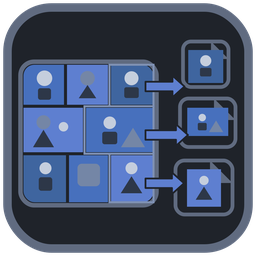

  

<h1 align="center">Image Sheet Splitter</h1>

Split image sheets into individual PNG files using solid separator backgrounds.

  <a href="#download">Download</a> | <a href="#getting-started">Get started</a> | <a href="#features">Features</a> | <a href="#updates-and-settings">Updates</a> | <a href="#development">Development</a>

## Features

Image Sheet Splitter is a Windows-first portable utility for sprite sheets, artwork sheets, UI atlases, and similar images whose pieces are separated by a solid background color.

- Batch-select files or folders, or drag and drop them from Windows Explorer.
- Supports PNG, JPEG/JPG, BMP, and WebP sources.
- Detects a solid separator background and exports each detected region as PNG.
- Uses generic dimension-based names for normal sheets, with optional descriptive names for closely matched Wii U Virtual Console artwork dimensions.
- Lets you choose the output directory and adjust tolerance/minimum crop sizes.
- Includes detachable Results, draggable layout splitters, hover help, built-in documentation, configurable logging, and configurable settings storage.
- Uses a stable portable launch filename: Image Sheet Splitter.exe.
- Includes a manual-install updater with cached conditional checks, cryptographic digest verification, rollback, and post-restart health confirmation.

## Download

No Image Sheet Splitter release has been published to GitHub yet.

The authorized release location is the repository's Releases page:

https://github.com/TechSavage1989/Image-Sheet-Splitter/releases

Until a release is published, build the Windows portable executable from source using the verified steps under Development. Do not use a guessed or stale version-specific asset URL.

## Requirements

Runtime target:

- Windows 10 or Windows 11, 64-bit.
- No separate Python installation is required for the packaged portable EXE.
- Normal user permissions are sufficient for regular use. Installing an in-place update requires write access to the folder containing the portable EXE.
- Internet access is optional except for update checks/downloads.

Build requirements:

- 64-bit Python 3.10 through 3.15 on Windows.
- Internet access while creating the isolated build environment and installing pinned build dependencies.

The current repository baseline has been syntax/unit tested in Linux. Native Windows packaging and updater replacement/rollback behavior must be validated by Windows CI or a Windows test system before a release is called verified.

## Getting started

1. Obtain a published portable release when one is available, or build it from source as described under Development.
2. If using a ZIP release, extract the single Image Sheet Splitter folder to the directory where you want to keep the app.
3. Run Image Sheet Splitter.exe.
4. Choose an output directory.
5. Add one or more image sheets with Add Image(s), Add Folder, or drag and drop.
6. Click Split Images.
7. Review the Results panel and the generated per-sheet output folders.

No installer or administrator-only setup is required for normal portable use.

## How to use

### Select sheets

Use Add Image(s), Add Folder, or drag supported files/folders onto the selection area. Folder input scans the selected folder's top level and does not recursively scan subfolders.

### Choose output

Select an output root on the main window. Each input sheet receives its own sanitized output folder. Most crops use neutral names such as Image_01_640x480.png.

Crops that closely match the known Wii U Virtual Console artwork dimensions use these convenience names:

- 128x128: Icon.png
- 854x480: Gamepad Image.png
- 1280x720: TV Image.png
- 170x42: Logo.png

Unrelated dimensions remain generic so the application can be used as a universal image-sheet splitter.

### Adjust detection

Start with the defaults. Increase or decrease Background tolerance only if the separator color varies or valid content is being lost. Increase Minimum width or Minimum height to filter small unwanted regions.

### Review results

The Results panel records file additions, detection counts, output files, warnings, and errors. It can be resized, hidden, detached, and reattached without clearing the current session view.

## Updates and settings

The stable updater uses this public GitHub Releases manifest:

https://github.com/TechSavage1989/Image-Sheet-Splitter/releases/latest/download/update-manifest.json

Checks occur:

- Shortly after startup.
- Every five minutes while the application remains active.
- After the app returns to the foreground if at least two minutes have passed since the last check.
- Manually from Help > Check for Updates.

The updater uses conditional requests/ETags and cached results. Network failures do not report the installed build as up to date. Throttling responses are respected with backoff. The application never automatically downloads an update and never automatically restarts.

When an update is available, the banner shows installed/latest versions, short release-note bullets, and explicit Download and Install and restart actions. Install is blocked while a split operation is active.

Downloaded updates are checked against the expected SHA-256 digest in the release manifest, then validated for safe archive paths, compression limits, expected executable identity, and expected version. SHA-256 verifies the downloaded bytes but is not proof of publisher code signing.

Default per-user state is stored under LocalAppData in ImageSheetSplitter. This includes the normal configuration locator, logs, cache, downloaded updates, staging, and one rollback backup. A custom JSON configuration location can still be selected in Settings. The first Image Sheet Splitter run can migrate the prior SpriteSheetSplitter configuration/locator when present.

## Troubleshooting

If no images are detected, confirm that full separator rows/columns exist and adjust Background tolerance gradually. If tiny fragments are exported, raise Minimum width or Minimum height.

If an update check fails because the computer is offline or GitHub is unavailable, the app reports that it could not verify the latest version rather than saying it is current. A throttled check will show when another check can be attempted.

If an update installs but the new application does not show a healthy visible window, the update helper restores the single retained rollback copy and relaunches the prior executable. Update staging files are only cleaned after the new app reports healthy and the helper has exited.

Legacy manually distributed Sprite Sheet Splitter builds did not contain the updater, so the one-time rename to Image Sheet Splitter.exe cannot rewrite shortcuts created by those older builds. Recreate any legacy shortcut once when moving to the first Image Sheet Splitter release. Future updates preserve the running executable filename, including intentional custom filenames.

## Development

Read these first:

- [AGENTS.md](AGENTS.md)
- [DEVELOPMENT_HANDOFF.md](DEVELOPMENT_HANDOFF.md)

Source layout:

- src/image_sheet_splitter: application, runtime paths, updater, and version identity.
- assets/icons: editable/current icon resources.
- build/windows: PyInstaller specification, hook, and generated Windows version metadata.
- scripts: build support, release/source packaging, version metadata, and root hygiene checks.
- tests: splitter, updater, path migration, and repository-hygiene tests.
- docs/releases: versioned release notes.

Run the repository checks from an extracted source tree or normal checkout:

    python scripts/check_root.py
    python -m unittest discover -s tests -v
    python -m py_compile src/image_sheet_splitter/*.py scripts/*.py

On Windows, build the portable executable by double-clicking Build Portable EXE.bat or running:

    Build Portable EXE.bat

The build creates Image Sheet Splitter.exe and release-ready assets under release. The release assets include the portable ZIP, update-manifest.json, and SHA256SUMS.txt.

Create a clean source archive without relying on .git metadata:

    python scripts/package_source.py

The repository's CI workflow is designed to enforce the root allowlist, run tests, build the Windows executable, and package release artifacts. Hosted CI status cannot be claimed until the workflow is committed and run on GitHub.
